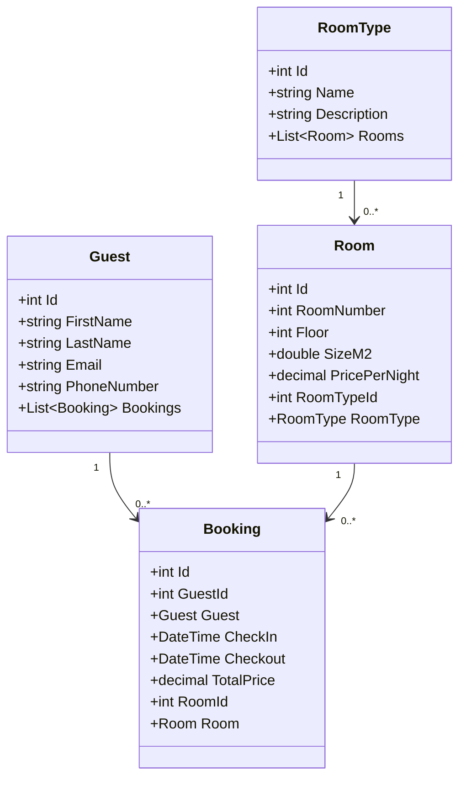

# Hotel Grandioso — Inlämning 1

Lazo Hussain 

## Så kör du projektet

1. Forka repot på GitHub och klona din fork
2. Öppna `HotelGrandioso.slnx` i Visual Studio (eller öppna mappen i VS Code)
3. Tryck **F5** för att starta

Via terminalen:

```bash
dotnet run --project HotelGrandioso
```

## Databas

- Databas: SQLite
- Entity Framework Core används för att hantera databasen.
- Databasen skapas och uppdateras med hjälp av migrationer.

För att skapa en migration:

```bash
dotnet ef migrations add InitialCreate
```
## UML-klassdiagram



## GDPR

FirstName: Viktigt för att identifiera gästen.

LastName: Används för att identifiera gästen då gästerna kan ha samma namn.

Email: Behövs för att kunna kontakta gästen angående bokningen.

PhoneNumber: Behövs för att kunna kontakta gästen vid frågor eller ändringar.
Jag valde att använda personuppgifter som enbart är relevanta för bokningshanteringen. Detta följer principen om dataminimering enligt GDPR lagen.
Det vill säga att dom exempeln ni på företaget ville ha inte är intressanta för ett bokningssystem. Därför valde jag bort religon och utseende på gästerna, då det inte spelar någon roll och inte är lämplig information enligt gdpr.

## Designmönster

Projektet använder repository-mönstret för att separera databashantering från övrig programlogik.
Klassen BookingRepository innehåller metoder för att hantera bokningar, avbokningar och visa information om rum och bokningar.
ConsoleMenu ansvarar för att visa programmets meny och ta emot användarens val.
Genom att dela upp ansvaret mellan olika klasser blir koden mer strukturerad och lättare att underhålla.
>

## Tekniker jag använt:

- C# / .NET 10
- Entity Framework Core
- SQLite
- Github
